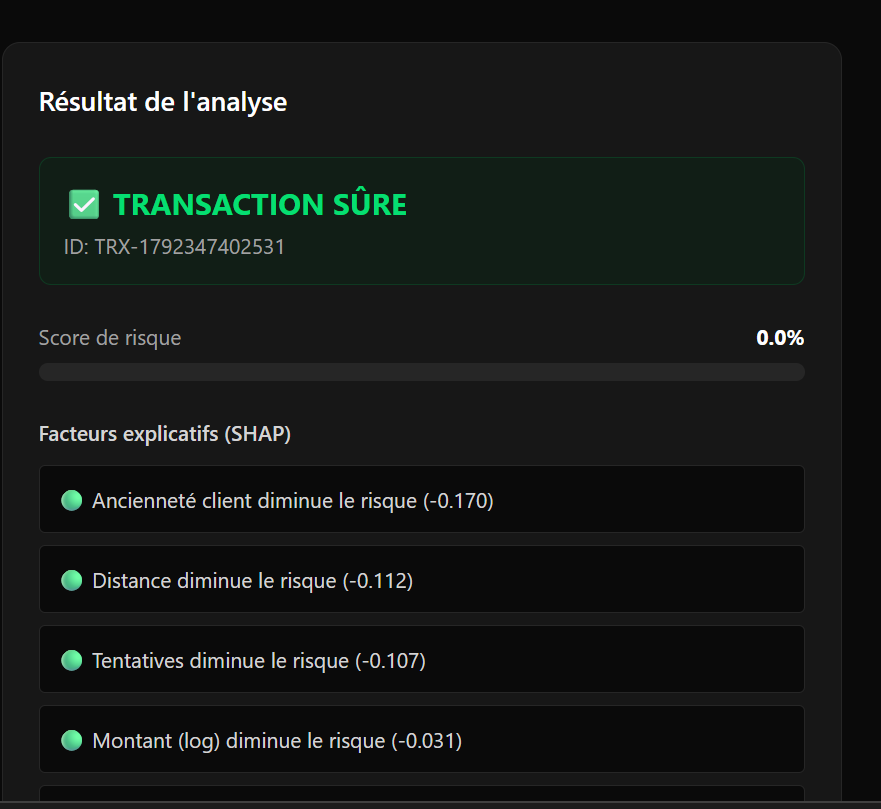
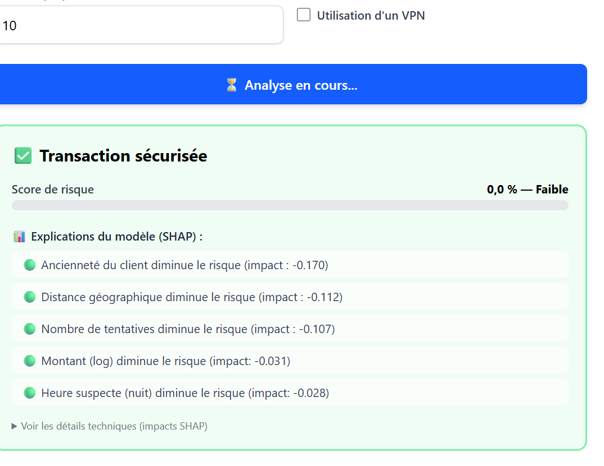

# 🛡️ Détection de Fraude E-commerce par IA

Système complet de détection de fraude en ligne combinant **Machine Learning** (Random Forest) et **explicabilité** (SHAP), exposé via une **API sécurisée** (FastAPI) avec une interface **React**.

---

## 🎯 Fonctionnalités

- ✅ Détection automatique de fraude par Random Forest
- ✅ Score de risque entre 0 et 1
- ✅ Explicabilité des décisions via SHAP
- ✅ API sécurisée (clé API + validation Pydantic)
- ✅ Interface web interactive (React + Tailwind)
- ✅ Analyse par lot (batch de 100 transactions)

## 📸 Aperçu

### 🖥️ Interface de détection

Interface web permettant de saisir une transaction et de visualiser instantanément le score de risque.

### 🔍 Explications SHAP

Chaque décision est accompagnée de ses facteurs explicatifs, permettant à l'analyste de comprendre pourquoi la transaction a été jugée suspecte.

### 📖 Documentation API (Swagger)

API auto-documentée avec FastAPI, permettant de tester tous les endpoints directement depuis le navigateur.

## 🏗️ Architecture

│ Frontend │ ─────────► │ Backend │ ─────────────► │ Modèle ML │
│ React+Vite │ │ FastAPI │ │ + SHAP │